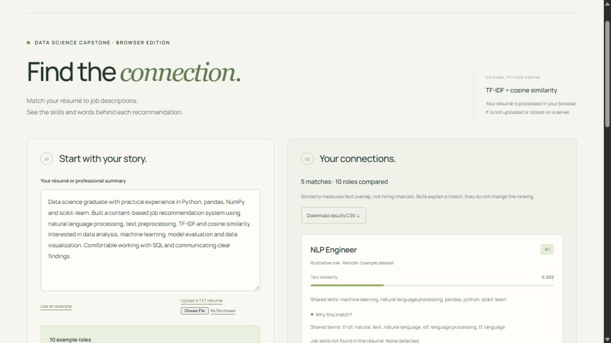

# AI-Based Job Recommendation System

An explainable resume-to-job matching application by **Bidhayak Baral**, developed as a data science capstone. It cleans resume and job-description text, builds unigram/bigram TF-IDF features, ranks jobs by cosine similarity, and explains shared terms and skill gaps.

**Status:** Working local Streamlit application with automated tests.  
[Try the browser edition](https://bidhayak.com/job-recommender.html) · [Portfolio](https://bidhayak.com/)



*Preview of the portfolio's browser edition. This repository contains the original Streamlit application and Python modules.*

## Features

- Upload a PDF, DOCX, or TXT resume, or use a local resume dataset.
- Import job data from CSV, XLSX, or XLS files, with optional Adzuna and USAJOBS integrations.
- Filter recommendations and inspect shared terms, matched skills, and possible skill gaps.
- Export recommendations, charts, and a blank human relevance judgment table.
- Calculate Precision@5, nDCG@10, and mean reciprocal rank from completed human ratings.
- Keep resume processing local when running the app on your own computer.

## Quick start

Use Python 3.11 or newer. From this repository:

```bash
python -m venv .venv
```

Activate the environment:

```powershell
# Windows PowerShell
.\.venv\Scripts\Activate.ps1
```

```bash
# macOS or Linux
source .venv/bin/activate
```

Then install dependencies and start the app:

```bash
python -m pip install -r requirements.txt
python -m streamlit run app.py
```

On Windows, `start_app.bat` can create the environment and launch the app. Streamlit normally opens at [localhost:8501](http://localhost:8501).

### Try it without API credentials

1. Open **Find jobs** and leave **Selecting official live sources** empty.
2. Upload `examples/jobs.csv` under **Optional LinkedIn, Indeed, or other job tables**.
3. Choose **Upload my resume** and upload `examples/resume.txt`.
4. Select **Retrieve and rank jobs**, then inspect the explanations.

The supplied examples are fictional. They demonstrate the workflow and do not represent current vacancies or a real applicant.

### Optional job APIs

Configure credentials in the app's API controls, through environment variables, or by copying `.streamlit/secrets.toml.example` to `.streamlit/secrets.toml` and filling it in locally:

- `ADZUNA_APP_ID` and `ADZUNA_APP_KEY`
- `USAJOBS_EMAIL` and `USAJOBS_API_KEY`

Only job-search requests are sent to the selected job providers. The local app does not send resume text to those APIs. Provider availability and quotas depend on your account. Keep credentials and generated exports out of version control.

## How matching works

1. Normalize resume and job text while preserving technology names such as C++, C#, and .NET.
2. Give job titles extra weight by repeating them twice in each job document.
3. Fit a shared unigram/bigram TF-IDF vocabulary over the prepared corpus.
4. Calculate resume-to-job cosine similarity and sort eligible jobs.
5. Explain the matches using weighted shared terms and a transparent skills vocabulary.

Skill explanations do not change the cosine-similarity ranking. Scores describe text alignment and are not probabilities of getting an interview or being hired.

## Project structure

| File | Purpose |
| --- | --- |
| `app.py` | Streamlit interface, file uploads, recommendations, and human evaluation |
| `job_recommender.py` | Data preparation, TF-IDF model, ranking, explanations, and exports |
| `job_sources.py` | Adzuna/USAJOBS adapters, standardization, deduplication, and local cache |
| `evaluation.py` | Human judgment templates and ranking metrics |
| `tests/test_system.py` | Existing offline API, caching, model, and evaluation checks |
| `examples/` | Fictional job data and resume for a credential-free demonstration |

## Run the tests

```bash
python -m unittest discover -s tests -v
```

Tests use local fixtures and do not need real API credentials or research datasets.

## Evaluation and limitations

Export a judgment template from the app, rate each result from 0 to 2, and calculate metrics from the completed table. These metrics measure the supplied human judgments; no benchmark accuracy or hiring-success rate is claimed.

TF-IDF primarily captures lexical overlap. It can miss synonyms, context, and transferable experience. Skill gaps depend on the supplied descriptions and vocabulary. Imported historical posting links may have expired.

Research datasets, personal resumes, API keys, caches, and generated evaluation evidence are excluded. If using the original capstone datasets, obtain them separately from their providers and retain their attribution and usage terms:

- Sneha Anbhawal, [Resume Dataset](https://www.kaggle.com/datasets/snehaanbhawal/resume-dataset).
- Arsh Kon, [LinkedIn Job Postings (2023–2024)](https://www.kaggle.com/datasets/arshkon/linkedin-job-postings).
